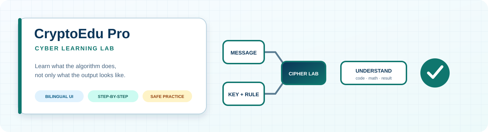
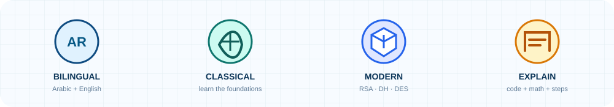
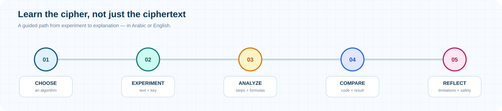

<div align="center">


# CryptoEdu Pro

### Cyber Learning Lab for classical and modern cryptography

<p><strong>Choose · experiment · analyze · understand</strong></p>

<a href="https://github.com/Dev-KAIDO/CryptoEdu-Pro/actions"></a>
<a href="https://github.com/Dev-KAIDO/CryptoEdu-Pro"></a>
<a href="https://github.com/Dev-KAIDO/CryptoEdu-Pro/blob/main/LICENSE"></a>
<a href="#تنبيه-أمني"></a>



[نظرة عامة](#نظرة-عامة) · [رحلة التعلم](#رحلة-التعلم) · [الخوارزميات](#الخوارزميات) · [التشغيل](#التشغيل) · [البنية](#البنية)

</div>

---

## نظرة عامة

**CryptoEdu Pro** تطبيق مكتبي ثنائي اللغة يساعد الطلاب والمطورين على فهم التشفير بالتجربة، لا بحفظ الناتج فقط. اختر الخوارزمية، أدخل النص والمفتاح، ثم شاهد النتيجة والكود والصيغة والخطوات الوسيطة من خلال واجهة عربية أو إنجليزية.



### ما الذي يميزه؟

- تجربة مباشرة للتشفير وفك التشفير.
- تحليل تدريجي للصيغ والمصفوفات والجولات عندما تكون متاحة.
- عرض الكود التعليمي مع شرح مبسط لكل جزء.
- دعم العربية والإنجليزية واتجاه RTL.
- ثيمات متعددة وسجل مختصر للعمليات وQuick Test.
- بنية Registry وService تفصل الخوارزميات عن واجهة المستخدم.

> **الفكرة التعليمية:** لا ترى ciphertext فقط؛ افهم كيف تحولت الرسالة، وأين دخل المفتاح، وما حدود الخوارزمية.

<a id="تنبيه-أمني"></a>

> **تنبيه أمني:** هذا المشروع تعليمي. الخوارزميات مطبقة من الصفر بهدف الفهم والتجربة، ولا تستخدمه لحماية كلمات المرور أو الملفات أو البيانات الحساسة. للاستخدام الحقيقي، استخدم مكتبات تشفير موثوقة ومراجعة أمنيًا.

## رحلة التعلم



1. **Choose** اختر الخوارزمية المناسبة للدرس.
2. **Experiment** أدخل النص والمفتاح وجرب العملية.
3. **Analyze** راقب الخطوات والصيغة والنتيجة الوسيطة.
4. **Compare** اقرأ الكود وقارنه بالمخرجات.
5. **Reflect** افهم القيود ولماذا لا تصلح بعض الخوارزميات للإنتاج.

## الخوارزميات

| المجموعة | الخوارزميات | ما الذي تتعلمه؟ |
| --- | --- | --- |
| أساسيات الاستبدال | Caesar · Affine · Vigenère | الإزاحة، المعكوس، والمفتاح الدوري |
| التشفير بالأزواج والمصفوفات | Playfair · Hill | الشبكات، الأزواج، وضرب المصفوفات modulo |
| المفاهيم الحديثة | Diffie-Hellman · RSA | تبادل المفاتيح والتشفير غير المتماثل |
| التشفير الكتلي | S-DES · DES | XOR، Feistel، الجولات، والتبديلات |

### ملاحظات مهمة عن الدعم

- الواجهة ثنائية اللغة، لكن دعم الأحرف العربية داخل كل خوارزمية يعتمد على النموذج الرياضي الخاص بها.
- S-DES وDES يتطلبان كتلًا ومفاتيح ثنائية بأطوال محددة.
- RSA وDES هنا لأغراض تعليمية وليسا بديلًا عن مكتبات التشفير الحديثة.

## التشغيل

### المتطلبات

- Python 3.10 أو أحدث.
- Tkinter.
- `customtkinter>=5.2.0`.
- `pyperclip`.

### التثبيت

```bash
git clone https://github.com/Dev-KAIDO/CryptoEdu-Pro.git
cd CryptoEdu-Pro
python -m venv .venv

# Linux / macOS
source .venv/bin/activate

# Windows PowerShell
# .venv\Scripts\Activate.ps1

python -m pip install --upgrade pip
python -m pip install -r requirements.txt
python main.py
```

في Linux قد تحتاج إلى تثبيت Tkinter:

```bash
sudo apt-get install python3-tk
```

## أمثلة سريعة

### Caesar

```text
Input:  HELLO WORLD
Key:    3
Output: KHOOR ZRUOG
```

### Vigenère

```text
Input:  ATTACKATDAWN
Key:    LEMON
Output: LXFOPVEFRNHR
```

### RSA التعليمي

```text
p = 61
q = 53
e = 17
```

## البنية

```text
CryptoEdu-Pro/
├── core/                  # الخوارزميات، Registry، Service، الحالة، التعليم
├── ui/                    # التشفير، التحليل، الكود، الثيمات، الترجمة، RTL
├── tests/                 # اختبارات الخوارزميات والخدمة والواجهة
├── tools/                 # Benchmark وسكربتات الإصلاح التاريخية
├── .github/workflows/     # Ruff، compileall، unittest، وبناء PyInstaller
├── CryptoEdu.spec         # إعداد النسخة التنفيذية
└── main.py                # نقطة تشغيل التطبيق
```

### طبقات المشروع

| الطبقة | الدور |
| --- | --- |
| `core.algorithms` | تنفيذ الخوارزميات والتحقق من المدخلات |
| `core.registry` | تعريف الخوارزميات وحقول المفاتيح مركزيًا |
| `core.service` | تشغيل العمليات بعيدًا عن Tkinter |
| `core.education` | الكود والأمثلة والشروحات التعليمية |
| `ui` | الواجهة، التحليل، الثيمات، الترجمة، وRTL |
| `tests` | اختبارات الرجوع والتحقق وواجهة المستخدم |

## التحقق والبناء

```bash
ruff check .
python -m compileall -q .
python -m unittest discover -s tests -v
```

لبناء نسخة تنفيذية:

```bash
python -m pip install pyinstaller
pyinstaller --clean --noconfirm CryptoEdu.spec
```

<details>
<summary><strong>افتح سجل التغييرات والتفاصيل المتقدمة</strong></summary>

راجع [`CHANGELOG.md`](CHANGELOG.md) لمراحل المشروع، و`tools/benchmark.py` لقياس أداء الخوارزميات، و`tools/legacy/` للملفات التاريخية غير المطلوبة للتشغيل.

</details>

---

<div align="center">


**Understand the cipher. Respect the limits. Build the habit.**

</div>
